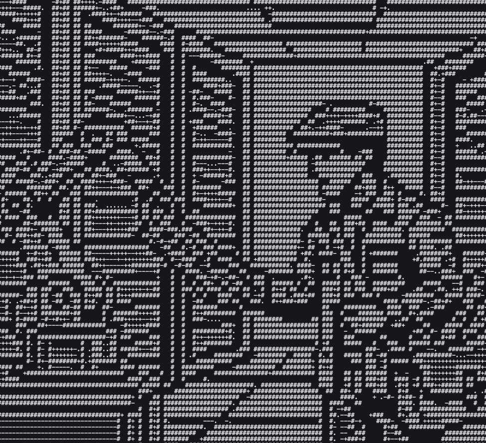

<div align="center">

>
> ### 🚨 Disclaimer 🚨
>
> **This is just a heads-up. We haven't seen any bans from GSearch use.**
>
> Not affiliated with Google. Uses the same public OAuth client and API as the [Antigravity CLI](https://antigravity.google/product/antigravity-cli).
>

---



# GSearch - Free Google Search MCP

[](https://go.dev)
[](LICENSE)
[](https://modelcontextprotocol.io)

Give Claude Code, Codex CLI, Cursor, Otherside, and other AI tools real-time web search powered by Google Search grounding. Single binary, zero runtime dependencies.

</div>


## Install

```bash
curl -fsSL https://raw.githubusercontent.com/daanielcruz/gsearch-mcp/main/install.sh | bash
```

Or build from source:

```bash
git clone https://github.com/daanielcruz/gsearch-mcp && cd gsearch-mcp
make build && ./gsearch-installer
```

The installer downloads the binary and configures Claude Code, Codex, Cursor and Otherside automatically (if available).

## How It Works

```
Claude Code / Codex CLI / Cursor / Otherside / Others
        | MCP (stdio)
   gsearch-server (Go binary)
        | OAuth2
   Google Code Assist API
        | googleSearch grounding
   Answer with [1][2][3] source links
```

When an AI tool calls `google_search`, GSearch returns a grounded answer with inline citations:

```
The current time in Sao Paulo is 08:13 AM.[1][2]
Sao Paulo observes Brasilia Time (BRT), UTC-3.[3]

Sources:
[1] [Time in Sao Paulo](https://...)
[2] [World Clock](https://...)
[3] [Time Zone Info](https://...)
```

## Pricing & Limits

GSearch uses the same Google Search grounding API as Antigravity CLI through its public OAuth client, or the Gemini API with an API key. Limits, availability, and billing depend on the selected authentication method and Google account.

The [official Gemini CLI](https://github.com/google-gemini/gemini-cli) states that free and Google One accounts migrated to Antigravity CLI on June 18, 2026, so GSearch now signs in through Antigravity's public OAuth client. Existing Gemini CLI credentials remain readable.

Rate limits are generous for normal usage. The server retries automatically with dynamic backoff on rapid bursts.

## Authentication

Two options:

1. **Google sign-in (Antigravity)**: the installer opens Antigravity CLI's public OAuth flow with PKCE S256 and a `localhost` loopback callback. Credentials are stored in `~/.gsearch/oauth_creds.json`.
2. **API key**: paste a Gemini API key from [aistudio.google.com](https://aistudio.google.com/apikey) into the installer, or set `GEMINI_API_KEY` / `GSEARCH_API_KEY`. This skips OAuth and does not require a project. Google sign-in always takes precedence: when OAuth credentials exist, these variables are ignored.

Antigravity sign-in resolves the Code Assist project automatically (SMS verification may be required on first use). If the account requires a user-defined project, the installer accepts an existing Project ID and retries. It does not create projects or enable billing. The default backend is `daily-cloudcode-pa.googleapis.com`; set `GSEARCH_ANTIGRAVITY_HOST=prod` to use `cloudcode-pa.googleapis.com`.

## Configuration

The installer configures everything automatically. For manual setup, add to your MCP client config:

```json
{
  "mcpServers": {
    "gsearch": {
      "command": "npx",
      "args": ["-y", "@daanielcruz/gsearch-mcp"]
    }
  }
}
```

Works with Claude Code (`~/.claude.json`), Cursor (`~/.cursor/mcp.json`), Otherside (`~/.otherside/.mcp.json`), and other MCP-compatible tools.

For Codex CLI (`~/.codex/config.toml`):

```toml
[mcp_servers.gsearch]
command = 'npx'
args = ['-y', '@daanielcruz/gsearch-mcp']
```

Set `GSEARCH_PROJECT` env var only if auto-detection fails.

## License

MIT
